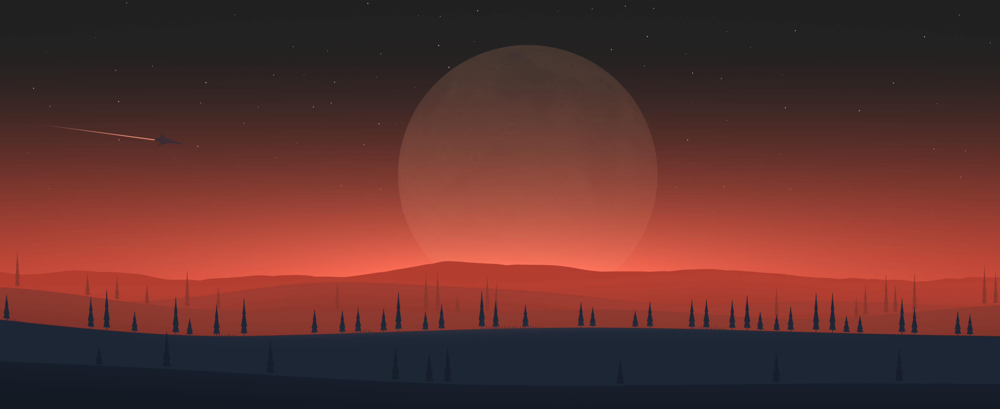
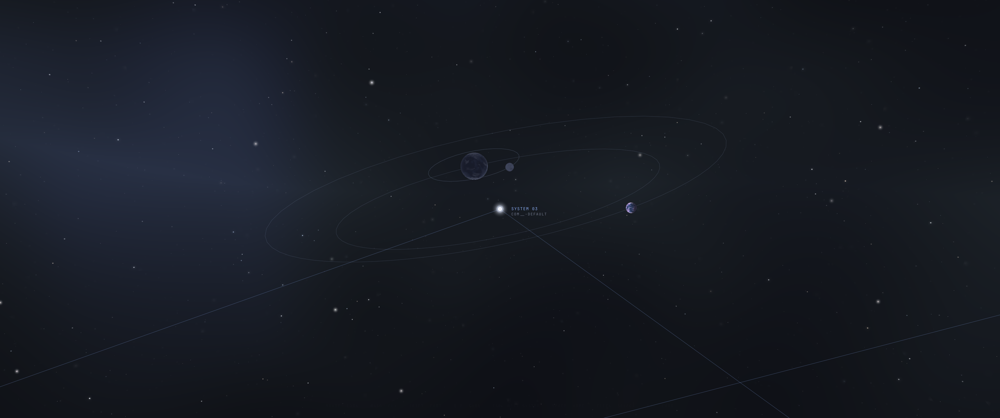

# Omarchy No Man’s Sky

A fully interactive space desktop for **Omarchy Quattro 4.5**, adapted from
[Eli F.’s Space rice](https://github.com/elifouts/Dotfiles) shown in
[this Hyprland post](https://www.reddit.com/r/hyprland/comments/1xo5kte/my_no_mans_sky_inspired_rice/).



Fly out of your desktop into a navigable star map. Workspaces are star systems,
open windows are planets, and selecting one takes you back to that workspace
or window with an animated landing. Explore procedural systems to generate a
new landscape and color palette. The scenery, moons, planets, nebulae, and stars
are GPU shaders; the camera and interface are QML and JavaScript.



The renderer runs alongside Omarchy’s existing shell. Your bar widgets,
launcher, notifications, dock, lock screen, and application shortcuts remain
available. This ports the landscape and interactive map, rather than installing
the author’s entire desktop configuration. It does not run the upstream installer.

## Controls

| Key | Action |
| --- | --- |
| **Super + Alt + N** | Open the star map; press again to land |
| **Super + Alt + W** | Generate a new world and palette |
| **Super + Alt + Escape** | Close the map immediately |
| Mouse | Aim the camera |
| W A S D / arrow keys / H J K L | Fly |
| Shift | Fly faster |
| Q / E | Turn |
| Tab / Shift + Tab | Visit the next / previous workspace system |
| Space | Fly toward the current workspace’s system |
| Click / Enter | Select a system, then land on a planet or workspace |
| Escape | Animated landing back on your current workspace |

The three desktop shortcuts were checked against the existing Omarchy bindings
on this machine and did not replace any actions.

## Install

Requires an active Omarchy 4.5 / Hyprland Lua session with Quickshell and Python
3.11 or newer. Qt Shader Tools (`/usr/lib/qt6/bin/qsb`) is needed only to rebuild
the shaders; compiled shaders are included. No root access or downloads are
required by the installer.

```sh
cd ~/Projects/omarchy-no-mans-sky
./bin/omarchy-nms install
```

Installation adds three keybindings and a theme, installs a user systemd service,
and enables it for future graphical sessions. Existing files are backed up before
they are changed. Run this from your normal desktop terminal, where the user
session bus and GPU are accessible.

Your monitor layout and global workspace rules are not edited:

| Workspaces | Display |
| --- | --- |
| 1–6 | Samsung C34J79x |
| 7–9 | Built-in Apple display |
| 10 / Super+0 | DZX small display, 1024×600 |

The map discovers workspace ownership from Hyprland instead of hardcoding display
connectors. Landing on an unexplored world reuses an empty workspace on the
focused display, or the current workspace when none is empty. It does not create
workspaces above 10. The wallpaper responds to each monitor’s own workspace,
and the largest display gets the main moon.

## Manage and roll back

```sh
omarchy-nms status       # Renderer state
omarchy-nms doctor       # Service, startup, renderer, and Hyprland checks
omarchy-nms map          # Open map / animated return
omarchy-nms world        # New terrain and palette
omarchy-nms abort        # Immediate return if a transition is inconvenient
omarchy-nms stop         # Stop the companion until the next login or start
omarchy-nms start        # Start it again
omarchy-nms uninstall   # Disable startup, remove integration, restore prior theme
```

Uninstallation removes only the added binding block, so keybindings you add later
are retained. Other managed files are restored only if they still match the
installed version; subsequent edits are preserved and reported. World state,
original-file backups, and the last installation manifest remain under
`~/.local/state/omarchy-no-mans-sky/`. The previous theme is restored only if
No Man’s Sky is still selected.

For a runtime problem, `Super+Alt+Escape` releases the map immediately. From a
terminal you can also run:

```sh
systemctl --user stop omarchy-no-mans-sky.service
journalctl --user -u omarchy-no-mans-sky.service -b
```

## How the adaptation works

- `quickshell/land/`: procedural scenery and per-monitor workspace parallax.
- `quickshell/starmap/`: perspective camera, workspace systems, window planets,
  live window captures during takeoff/landing, and navigation.
- `quickshell/common/`: adapted rendering components, isolated scene state,
  palette generation, and automatic resolution reduction during slow transitions.
- `theme/`: initial Omarchy palette and HUD surface styling.
- `hypr/`: additive shortcuts and theme-specific thin borders / square corners.
- `tools/control.py`: installation, safe restoration, service management, and
  synchronization of generated world palettes through Omarchy’s theme templates.

World settings are isolated from upstream’s pywal and profile system. Palette
changes are applied after flight transitions finish. Omarchy’s normal theme
templates generate application colors; the controller updates the running shell,
terminals, and Hyprland locally. It does not invoke remote-machine theme hooks
or change the fallback wallpaper. Applications which read themes at launch pick
up their generated settings the next time they open. Switching to a different
Omarchy theme stops automatic palette syncing; stop the companion to reveal
Omarchy’s wallpaper again.

The original desktop widgets, launcher, settings panels, pypr scratchpad daemon,
and lock screen are not imported. Omarchy provides those functions. Normal
Hyprland special workspaces with windows still appear in the map. Flight can
temporarily capture your open windows for the transition; these frames remain
inside the renderer and are not saved or transmitted.

This checkout must remain at its installed path. The user service and command
point to it so edits can be reviewed in Git and QML changes can reload live.
Uninstall before moving the repository, then install from its new location.

## Development and verification

```sh
make shaders  # Recompile all three GLSL shaders with the installed Qt version
make check    # Installer rollback, ownership, and palette validation tests
qs -p ./quickshell --no-duplicate  # Preview without the installer
```

On the target three-monitor desktop, verification covered successful shader
compilation, loaded QML without component errors, keyboard flight and system
selection, animated cross-monitor landing, emergency close, palette syncing,
unchanged workspace ownership, and clean `hyprctl configerrors` output.

Optional frame-timing diagnostics can separate flight performance from takeoff
and landing. They are disabled by default and do not drive rendering while idle:

```sh
qs ipc -p ./quickshell call nms profile true
omarchy-nms map
# Fly, then press Escape to land normally.
qs ipc -p ./quickshell call nms performance
qs ipc -p ./quickshell call nms profile false
```

The report records primary-display frame-swap intervals by phase: average frame
rate, median and 95th-percentile interval, and frames longer than 25 ms. An
ordinary landing retains the last report; an emergency abort discards it.
These are application frame timings, not a guarantee of compositor presentation
rate. After restarting the companion on this machine, a short flight measurement
averaged 59.8 fps; takeoff and landing had slower frames. A trial which cached
the transition blur did not consistently improve landing and was not retained.

## Credits and license

The landscape shader, space shader, camera, planet rendering, and transition
design come from **Eli F. / elifouts**. This repository is an Omarchy integration
and adaptation of that work, not an independently recreated camera or renderer.
See [UPSTREAM.json](UPSTREAM.json) for the pinned commit and original file hashes.

Distributed under **GPL-3.0**, matching the upstream project. See [LICENSE](LICENSE).
